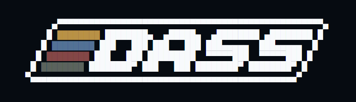
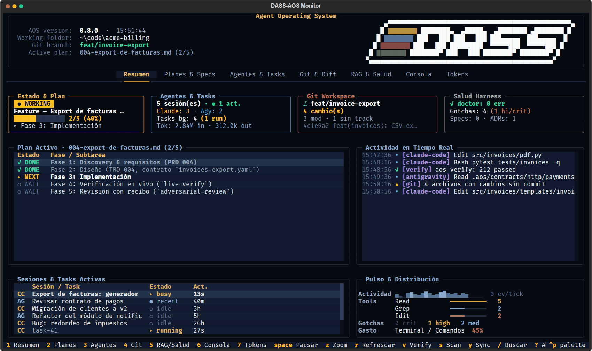
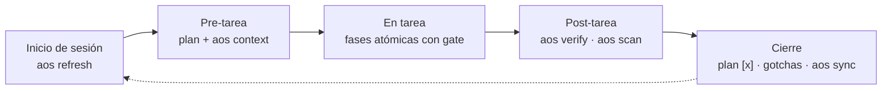
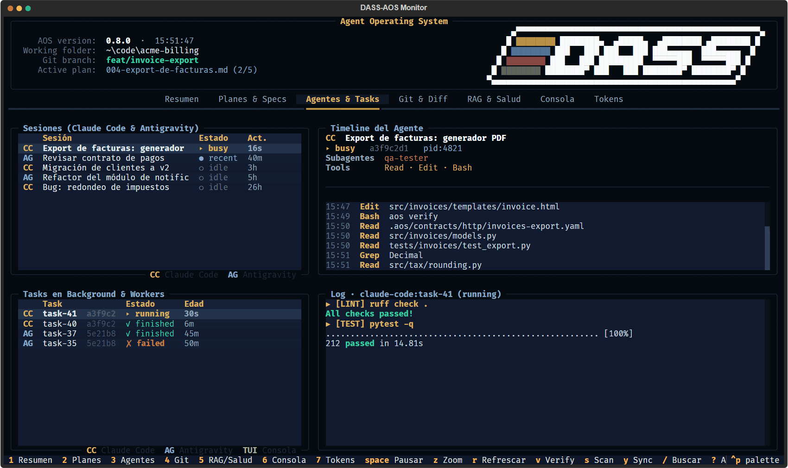
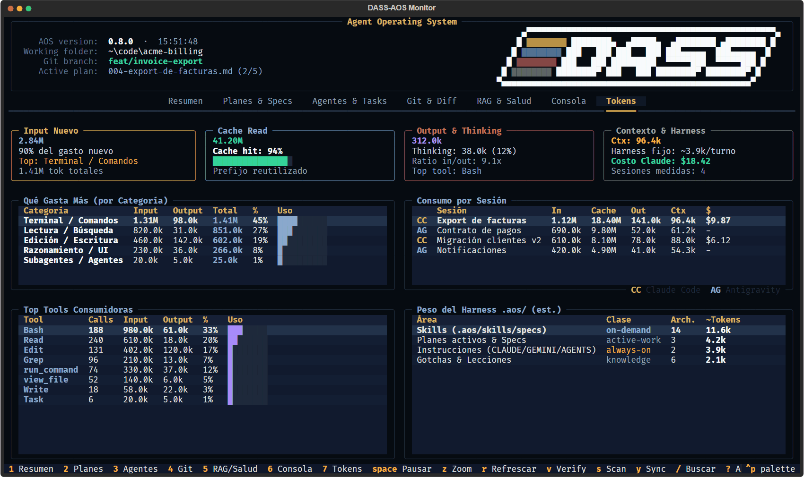

<p align="center">
  
</p>

<h3 align="center">Agent Operating System</h3>

<p align="center">
  Memoria, contratos y verificación para trabajar con agentes de IA<br>
  sin perder el control del proyecto.
</p>

<p align="center">
  <a href="https://python.org"></a>
  
  
  <a href="LICENSE"></a>
</p>

<p align="center">
  <a href="#instalación">Instalación</a> ·
  <a href="#cómo-funciona">Cómo funciona</a> ·
  <a href="#monitor-en-tiempo-real">Monitor</a> ·
  <a href="#referencia-de-comandos">Comandos</a> ·
  <a href="docs/ARCHITECTURE.md">Arquitectura</a>
</p>

<p align="center">
  
</p>

DASS-AOS es un CLI stack-agnostic que le da a tu agente de IA (Claude Code, Antigravity, Gemini CLI, Codex, Cursor, Windsurf, OpenCode) lo que no trae de serie: memoria del proyecto entre sesiones, contratos que no puede inventarse y un ciclo de verificación antes de dar nada por terminado. Todo vive en una carpeta `.aos/` dentro de tu repositorio, en texto plano y versionable.

Tú decides qué se construye, apruebas planes y decisiones de arquitectura, y revisas el resultado. El agente hace el trabajo operativo.

---

## Qué resuelve

| Problema | Qué pasa sin DASS-AOS | Qué hace DASS-AOS |
|---|---|---|
| **Amnesia entre sesiones** | El agente vuelve a caer en trampas ya resueltas | `aos refresh` carga gotchas, lecciones, specs y el plan activo al empezar |
| **Degradación de la arquitectura** | Cambios que ignoran dependencias y decisiones previas | Grafo de código (codebase-memory), ADRs y contexto RAG antes de tocar código |
| **Interfaces inventadas** | Endpoints, eventos o tipos sin contrato | Contract-First: solo lo declarado en `.aos/contracts/` |
| **Cierres sin verificar** | Tareas "terminadas" sin tests ni análisis | `aos verify`, `aos scan`, verificación en vivo y revisión adversarial con recibo |

---

## Instalación

```bash
pip install git+https://github.com/Dass-19/dass-aos.git
```

Registra el ejecutable `aos` (equivalente: `python -m dass_aos <comando>`). El núcleo no tiene dependencias; los extras son opcionales:

```bash
pip install "dass-aos[tui]"    # monitor en tiempo real (Textual, Python ≥ 3.9)
pip install "dass-aos[rag]"    # búsqueda semántica (fastembed + sqlite-vec)
pip install "dass-aos[scan]"   # Semgrep + Checkov
```

Desde la raíz de tu proyecto, indicando las herramientas de IA que usas:

```bash
aos init claude-code antigravity    # o una sola; más adelante `aos init <otra>` la añade
aos tui                             # en otra terminal, para seguir al agente
```

Herramientas soportadas: `claude-code`, `antigravity`, `gemini-cli`, `codex`, `opencode`, `cursor`, `windsurf`. Sin argumento, `aos init` usa las ya configuradas o las que detecta (`.claude/`, `.cursor/`, `.agents/hooks.json`…); si no encuentra ninguna, no escribe nada y te pide que la indiques.

<details>
<summary><b>Qué genera <code>aos init</code></b></summary>

- `.aos/`: estado local del proyecto (contratos, planes, gotchas, ADRs, roles, skills y configuración).
- `.aos/config.json` con los comandos de lint/test **detectados según el stack** (`package.json`, `pyproject.toml`, `Cargo.toml`, `go.mod`). Edítalo si la detección no acierta.
- **Solo el archivo de instrucciones de cada herramienta elegida**, gobernado por DASS-AOS y preservando la sección `## Notas personalizadas del proyecto`: `claude-code` → `CLAUDE.md`; `antigravity` y `gemini-cli` → `GEMINI.md`; `codex` y `opencode` → `AGENTS.md`; `cursor` → `.cursorrules`; `windsurf` → `.windsurfrules`. La elección queda en `.aos/config.json` (`"tools"`), y `aos sync` crea solo esos archivos (los que ya existan de otras herramientas se siguen actualizando, no se borran).
- Para `claude-code` y `antigravity`, sus nativos (subagentes y skills) vía `aos adapt-native`. El hook de inicio de sesión queda **pendiente** hasta que lo revises y ejecutes `aos adapt-native <herramienta> --yes`.
- `.git/hooks/pre-commit` (si hay repo git y no existe ya un hook): ejecuta `aos verify`. Nunca bloquea si DASS-AOS o Python no están instalados. Si ya tenías un hook (p. ej. de 0.4.0), `aos init` no lo pisa: reemplázalo a mano por el que delega en `.aos/hooks/pre_commit.py`.

</details>

<details>
<summary><b>Dependencias externas</b></summary>

`aos refresh` avisa de las que faltan **solo si aplican al proyecto**.

| Herramienta | Para qué | Cuándo aplica | Instalación |
|---|---|---|---|
| Semgrep | SAST (`aos scan`) | Siempre | `pip install "dass-aos[scan]"` o `pip install semgrep`. En Windows nativo está en beta: usa `PYTHONUTF8=1`; si falla, WSL o Docker. |
| Checkov | IaC, contenedores y pipelines (`aos scan`) | Solo si hay IaC (Terraform, Bicep, Dockerfile, Helm, Kustomize, Serverless, CDK, CI pipelines… ver `applies_when` en `checkov-scan.md`) | `pip install "dass-aos[scan]"` o `pip install checkov` |
| RAG local (`fastembed` + `sqlite-vec`) | Búsqueda semántica híbrida en `aos context` / `aos refresh` | Opcional (sin él funciona en modo léxico `FTS5`/BM25) | `pip install "dass-aos[rag]"` |
| TUI en tiempo real (`textual`) | Monitor interactivo en terminal (`aos tui`) | Opcional (requiere Python ≥ 3.9) | `pip install "dass-aos[tui]"` |
| codebase-memory | Grafo estructural del código (MCP) | Siempre | Binario `codebase-memory-mcp` en el PATH (ver su repositorio). Indexa cada proyecto en la base de datos del usuario, no en `.aos/`: la primera vez, `index_repository` con la ruta del proyecto |
| context7 | Documentación actualizada de librerías (MCP); obligatorio para `adapt-native` | Siempre | Servidor remoto `https://mcp.context7.com/mcp`, sin instalación. API key opcional (más rate limit) en context7.com |
| playwright-cli | Vía web de `live-verify`: el agente abre la app en un navegador sin interfaz, la recorre, captura y lee la consola | Solo si hay frontend web (`package.json` o `*.html` a uno o dos niveles) | `npm install -g @playwright/cli@latest` y una vez `playwright-cli install --skills -g` (skill global de Claude Code). Otras herramientas leen la `SKILL.md` que indica `playwright-cli --help` |

Los servidores MCP se declaran una sola vez, de forma neutral, en `.aos/mcp-config.json`; `adapt-native` los traduce al formato de tu herramienta.

</details>

<details>
<summary><b>Actualizar proyectos de versiones anteriores</b></summary>

- **Anteriores a 0.6.0** (tienen los cinco archivos de instrucciones): ejecuta `aos init <tus herramientas>` una vez para declararlas. Los archivos de las demás no se borran; si no los usas, bórralos tú y ya no se recrearán.
- **Anteriores a 0.7.0**: para recibir la capa de requisitos y el flujo por riesgo, borra `.aos/hooks/*.md`, `.aos/plans/templates/*.md` y ejecuta `aos init`, después `aos sync` (`spec-driven` y las skills reescritas llegan solas por `sync`; `.aos/specs/` y `.aos/knowledge/lessons/` se crean al inicializar). `.aos/config.json` gana `deny_paths`: si falta, `aos doctor` avisa y el pre-commit no bloquea secretos.
- **Skills hechas a mano** (p. ej. una `adversarial-review.md` propia): `aos sync` las omite con "OMITIDO: editado a mano". Mueve lo propio del proyecto a `<skill>.local.md`, borra el archivo y vuelve a ejecutar `aos sync`. Los hooks (`.aos/hooks/*.md`) y las plantillas de plan son del proyecto y `sync` no los toca: para recibir la versión nueva, bórralos y ejecuta `aos init`.

</details>

---

## Cómo funciona

Cada tarea pasa por el mismo ciclo. Las especificaciones de cada fase viven en `.aos/hooks/` (`session-start.md`, `pre-task.md`, `post-task.md`).



| Fase | Tú | El agente |
|---|---|---|
| **Setup** | `aos init` una vez por repositorio | — |
| **Contexto** | Notas en `CLAUDE.md` y `.aos/**/*.local.md` | Lee las directivas de su bloque gestionado |
| **Inicio de sesión** | Plantea el objetivo | `aos refresh`: gotchas, grafo de código y plan activo |
| **Planificación** | Revisa y aprueba el plan | `aos plan new`: fases atómicas y contratos en `.aos/contracts/` |
| **Implementación** | Supervisa el diff (`aos tui`) y resuelve bloqueos de diseño | Codifica en unidades atómicas ligadas al contrato |
| **Verificación** | Revisa los reportes | `aos verify` y `aos scan`: linters, tests, Semgrep y Checkov |
| **Cierre** | Aprueba el commit, merge y push | Marca la fase `[x]`, documenta gotchas y ejecuta `aos sync` |

### Requisitos: PRD → TRD → contratos → plan

El *qué* y el *por qué* no se reconstruyen leyendo el diff ([ADR-007](.aos/decisions/ADR-007-capa-de-requisitos-y-grafo-de-codigo.md)). Viven en `.aos/specs/`:

| Documento | Responde a | Lo revisa |
|---|---|---|
| `NNN-<slug>.prd.md` | **PRD**: qué problema, para quién y **cómo sabemos que funcionó** (criterios de aceptación medibles) | negocio / producto |
| `NNN-<slug>.trd.md` | **TRD**: cómo se construye y por qué así; contratos afectados, datos, riesgos, plan de prueba y observabilidad | ingeniería |

```bash
aos spec new prd --title "Export de facturas"   # → .aos/specs/001-export-de-facturas.prd.md
aos spec new trd --title "Export de facturas"   # → .aos/specs/001-export-de-facturas.trd.md (mismo NNN)
```

- El PRD y el TRD **comparten el número** con el `.design.md` de la misma funcionalidad.
- **La spec se cita, nunca se parafrasea**: los handoffs a subagentes y el `.design.md` apuntan a la ruta y a la sección.
- **Vía corta:** un cambio pequeño y comprendido no necesita PRD. Sin criterios de aceptación medibles, no se pasa al TRD.
- El PRD y el TRD **sobreviven al plan**: cuando el plan se archiva, la spec se queda.

### Entrega por riesgo

Cuatro skills del motor ([ADR-006](.aos/decisions/ADR-006-flujo-de-entrega-del-motor.md), [ADR-008](.aos/decisions/ADR-008-enrutado-por-riesgo-y-revision-con-recibo.md)), sacadas de proyectos reales:

| Skill | Cuándo | Qué hace |
|---|---|---|
| `spec-driven` | Funcionalidad con alcance de producto | PRD con criterios medibles → TRD que cita el PRD → contratos → plan que enlaza ambos |
| `phased-delivery` | Cambios con **riesgo nombrado** (datos, seguridad, contratos compartidos, concurrencia, entrega) o poco comprendidos | Línea base → exploración → decisiones → plan con un `Gate:` por fase → implementación → `live-verify` → revisión → cierre |
| `live-verify` | Al cerrar una fase que toca UI, API, CLI o escritorio | Levanta la app en un entorno desechable, la ejercita (`playwright-cli`, `curl`, el comando real), mira la evidencia y se corrige, hasta 3 rondas |
| `adversarial-review` | Cambios con riesgo nombrado, antes de cerrar una fase | Congela el candidato → tier por riesgo (0 / 1 / 4R lentes) → un `adversarial-verifier` intenta refutar cada hallazgo → **una sola corrección acotada** |

**El tamaño se decide por riesgo y comprensión, nunca por número de archivos.** Un bug de tres líneas en una migración es grande; un renombrado en veinte archivos de texto es pequeño. Sin un **motivo de delegación** que se pueda nombrar (exploración, escritores en paralelo, backstop de contexto, verificador independiente), el agente trabaja inline, sin subagentes.

Lo propio de cada proyecto va en el `.local.md` de cada skill: lentes, gates con comandos exactos, cómo levantar la app. **El entorno desechable se declara solo en `live-verify.local.md`.** La evidencia web queda en `.playwright-cli/`, que `aos init` y `aos sync` añaden a `.gitignore`.

---

## Monitor en tiempo real

```bash
pip install "dass-aos[tui]"
aos tui [--interval 1.5]
```

Vista de solo lectura de `.aos/`, Git y las sesiones de agentes que trabajan en este proyecto, mientras trabajan.

<table>
  <tr>
    <td></td>
    <td></td>
  </tr>
  <tr>
    <td align="center"><sub>Agentes &amp; Tasks: sesiones, timeline de tools y logs</sub></td>
    <td align="center"><sub>Tokens: consumo del proyecto por categoría, tool y sesión</sub></td>
  </tr>
</table>

| Tecla | Pestaña | Contenido |
|---|---|---|
| `1` | Resumen | Plan activo, sesiones y tasks, actividad, gotchas |
| `2` | Planes & Specs | Planes, PRD/TRD y ADRs |
| `3` | Agentes & Tasks | Sesiones Claude Code (CC) / Antigravity (AG), timeline, logs de tasks |
| `4` | Git & Diff | Cambios, commits, diff (`.md` renderizado) |
| `5` | RAG & Salud | `aos context` (`/`), `aos doctor`, gotchas, nativos |
| `6` | Consola | `aos verify` (`v`), `scan` (`s`), `sync` (`y`), `refresh` (`f`) |
| `7` | Tokens | Input, cache, output, contexto y coste por categoría, tool y sesión |

`z` zoom · `space` pausa · `r` refresca · `?` ayuda · `q` sale.

Los datos de agentes y tokens salen solo de archivos locales:
- **Claude Code**: `~/.claude/projects/<slug>/*.jsonl` y `<sesión>/subagents/*.jsonl`; `<slug>` = ruta con todo carácter no alfanumérico → `-`. Deduplicado por `message.id:requestId`.
- **Antigravity**: `workspace_uris` de `~/.gemini/antigravity/conversation_summaries.db`; respaldo: ruta en el transcript.

---

## Adaptar DASS-AOS al proyecto

Los roles y skills del motor son genéricos a propósito. Cada proyecto los adapta sin editarlos ([ADR-003](.aos/decisions/ADR-003-base-motor-agregados-locales.md)):

| Quiero… | Hago… |
|---|---|
| Añadir reglas propias a un rol del motor | Crear `.aos/agents/<rol>.local.md`. `aos sync` lo anexa al rol como "Agregados del proyecto". |
| Ajustar una skill del motor | Crear `.aos/skills/specs/<skill>.local.md`. |
| Un rol o skill exclusivo del proyecto | Crear `.aos/agents/<nuevo>.md` o `.aos/skills/specs/<nueva>.md`. El motor no lo toca. |
| Recibir mejoras del motor | `pip install -U dass-aos && aos sync`. Los roles/skills base se regeneran; los `.local.md` se conservan. |
| Cambiar comandos de verificación | Editar `lint_command` / `test_command` / `migration_command` en `.aos/config.json`. |

- Los `.aos/agents/*.md` y `.aos/skills/specs/*.md` del motor llevan el marcador `<!-- DASS-AOS-GENERATED`: **no los edites**. Si `sync` encuentra uno editado a mano, no lo sobreescribe y te indica que muevas los cambios al `.local.md`.
- Una skill puede declarar `applies_when: ["glob", ...]`: solo se lista en las instrucciones si algún glob encuentra archivos en el proyecto (p. ej. `db-migration-check` solo aparece si hay `migrations/`, `alembic.ini`, `prisma/schema.prisma`…).
- Toda skill declara `cost:` (`on-demand`, `always-on`, `enforced` o `delegated`). **La prosa siempre activa es el bloque gestionado** de `CLAUDE.md`/`AGENTS.md`, y es lo caro: si crece, `aos doctor` avisa y propone mover detalle a una skill.

### Integración nativa (`aos adapt-native`)

`.aos/` es la fuente única. Cada herramienta necesita sus propios formatos (subagentes, skills, hooks), que se generan desde `.aos/` y **no se commitean**: cada dev los genera en su máquina.

```bash
aos adapt-native claude-code --yes      # o: antigravity. --dry-run muestra los cambios sin escribir
```

- Sin `--yes` escribe subagentes y skills, pero **no** hooks ni permisos: los muestra como PENDIENTE para que los revises.
- Es idempotente ([ADR-005](.aos/decisions/ADR-005-generador-nativo-por-herramienta.md)): nunca toca un archivo sin el marcador `DASS-AOS-GENERATED`, fusiona JSON conservando lo ajeno y borra solo lo que generó y ya no aplica.
- No crea servidores MCP: reutiliza los que tengas a nivel de usuario (`codebase-memory`, `context7`) y avisa si falta alguno.

<details>
<summary><b>Claude Code vs Antigravity</b></summary>

| | Claude Code | Antigravity 2.0 |
|---|---|---|
| Roles | `.claude/agents/<rol>.md`; `tools_allowed` → `disallowedTools` (**nativo**). Prefijos de shell y subconjunto de MCP: convención | Sin subagentes en archivo: el bloque gestionado de `GEMINI.md` indica delegar con `define_subagent` y qué roles van sin escritura (**convención**) |
| Skills | `.claude/skills/<x>/SKILL.md` | `.agents/skills/<x>/SKILL.md` |
| Inicio de sesión | Hook `SessionStart` en `.claude/settings.local.json` (**nativo**) | Hook `PreInvocation` en `.agents/hooks.json`, que inyecta `aos refresh` una vez por conversación (**emulado**) |
| MCP | Usuario (`~/.claude.json`) o plugin | Global (`~/.gemini/config/mcp_config.json`) |

</details>

**Otras herramientas** (Codex, Cursor, OpenCode, Gemini CLI…): el bloque gestionado le ordena a su agente ejecutar la skill `adapt-native` ([ADR-004](.aos/decisions/ADR-004-adaptacion-nativa-delegada.md)), que consulta el formato vigente con context7 o la web y genera lo equivalente. Traduce `tools_allowed` del vocabulario neutral (`read`, `search`, `edit`, `write`, `shell`, `shell:<prefijo>`, `web`, `mcp:<servidor>`); `aos sync` falla si un rol usa un valor fuera del vocabulario.

**Desincronización:** lo hecho queda en `.aos/native/<herramienta>.json` (fuera de git), con `enforcement` y `source_hash`. Si cambias roles, skills, hooks o MCP en `.aos/`, `aos refresh` y `aos sync` marcan **DESACTUALIZADO** e indican qué volver a ejecutar.

### Auditoría del harness (`aos doctor`, `aos status`)

```bash
aos doctor            # solo diagnóstico: no escribe nada y no bloquea commits
aos doctor --strict   # sale con 1 si hay hallazgos de nivel error
aos status            # Working | Checking | Ready | Needs decision
aos status --json     # lo mismo, para scripts y hooks
```

`aos doctor` responde a una pregunta: **¿lo que el agente carga coincide con lo que `.aos/` declara?** Comprueba frontmatter de skills y roles, skills que no se listan, `.local.md` huérfanos, el tamaño del bloque siempre activo (~tokens), `tools_allowed`, nativos desactualizados, PRD sin TRD, `deny_paths` y dependencias externas. Ningún hook lo ejecuta.

`aos status` deriva el estado de los archivos, no del criterio de un modelo: pregunta sin respuesta o fase de requisitos → `Needs decision`; fase de implementación → `Working`; de verificación → `Checking`; sin fases pendientes → `Ready`.

---

## Referencia de comandos

| Comando | Función | Lo ejecuta |
|---|---|---|
| `aos init [<herramienta>...] [--project-root <ruta>]` | Inicializa `.aos/` para las herramientas indicadas (o detectadas): su archivo de instrucciones y, si tienen generador, sus nativos | Desarrollador |
| `aos tui [--project-root <ruta>] [--interval <seg>]` | Monitor en tiempo real del proyecto. Requiere `[tui]` | Desarrollador |
| `aos refresh [--gotchas-limit <N>]` | Gotchas recientes, estado del grafo de código, tarea activa y contexto RAG | Agente (inicio de sesión) |
| `aos context [<query>] [--kind <tipo>] [--limit N] [--reindex] [--json]` | Fragmentos relevantes de `.aos/` (RAG híbrido `sqlite-vec` + `FTS5`, o léxico sin `[rag]`). Sin query usa la siguiente tarea del plan | Agente / Desarrollador |
| `aos plan new <tipo> --title <título>` | Plan activo desde plantilla (`feature`, `bugfix`, `refactor`, `security`) | Agente (pre-tarea) |
| `aos spec new prd\|trd --title <título>` | `.aos/specs/NNN-<slug>.{prd,trd}.md`; el TRD reutiliza el número del PRD | Agente (pre-tarea) |
| `aos verify [--type lint\|test\|migration] [--strict]` | Linters, tests y migraciones (configurados o autodetectados) | Agente (post-tarea) |
| `aos scan [--tool semgrep\|checkov] [--dry-run]` | SAST (Semgrep) e IaC (Checkov, solo si hay IaC) | Agente (post-tarea) |
| `aos status [--json]` | `Working`, `Checking`, `Ready` o `Needs decision`, derivado de archivos | Agente / Desarrollador |
| `aos doctor [--strict]` | Audita el harness contra lo que declara `.aos/`. Solo lectura | Agente / Desarrollador |
| `aos sync [--project-root <ruta>]` | Regenera bloques gestionados y roles/skills del motor, respetando notas humanas y `.local.md` | Agente (post-tarea) |
| `aos update [--project-root <ruta>]` | Actualiza `.aos/`, plantillas, `.gitignore`, instrucciones y nativos en proyectos ya inicializados | Desarrollador |
| `aos adapt-native <herramienta> [--dry-run] [--yes]` | Nativos de `claude-code` o `antigravity` desde `.aos/` (hooks y permisos solo con `--yes`) | Desarrollador / Agente |
| `aos refresh --hook antigravity` | Hook de Antigravity: lee su JSON por stdin e inyecta el refresco una vez por conversación | Antigravity |
| `aos native-hash` | Hash de las fuentes que `adapt-native` registra en su manifiesto | Agente (skill `adapt-native`) |
| `aos generate-client --contract <ruta>` | Stubs de cliente tipados desde contratos OpenAPI | Agente / Desarrollador |

### Roles de agentes

En `.aos/agents/`, cada uno con tools permitidas, límites y formato de salida:

| Rol | Para qué |
|---|---|
| `app-builder` | Diseño e implementación end-to-end por fases, guiada por contratos |
| `architect` | ADRs, contratos y límites del sistema |
| `reviewer` | Revisión de código y seguridad en formato `file:line` |
| `refactorer` | Mejoras estructurales sin cambiar el comportamiento observable |
| `security-auditor` | Autenticación, secretos, IaC y dependencias |
| `qa-tester` | Tests, regresiones y smoke tests de contratos; evidencia con `live-verify` |
| `adversarial-verifier` | Intenta refutar cada hallazgo de revisión contra el código real; no edita |

### CI/CD

`aos init` copia pipelines a `.aos/ci/`: `github-actions/security.yml` (copiar a `.github/workflows/`) y `gitlab/security.yml`. Ambos ejecutan Semgrep y Checkov en contenedores en modo estricto, con las mismas comprobaciones que el agente corre en local.

---

## Estructura

<details>
<summary><b>Proyecto gestionado (<code>.aos/</code>)</b></summary>

```
mi-proyecto/
├── .aos/
│   ├── config.json            Comandos de verificación + deny_paths del pre-commit
│   ├── mcp-config.json        Servidores MCP neutrales (codebase-memory, context7)
│   ├── native/                Manifiestos de adapt-native (por dev, fuera de git)
│   ├── .backups/              Snapshots de lo que el motor reescribió (fuera de git)
│   ├── agents/                Roles (generados + *.local.md del proyecto)
│   ├── skills/specs/          Skills (generadas + *.local.md del proyecto)
│   ├── skills/bin/            Utilidades standalone (smoke test, commit atómico)
│   ├── hooks/                 Especificaciones de lifecycle + pre_commit.py
│   ├── contracts/             OpenAPI 3.x y CloudEvents schemas
│   ├── specs/                 PRD y TRD (NNN-<slug>.prd.md / .trd.md)
│   ├── plans/{active,archive,templates}/
│   ├── knowledge/gotchas/     Trampas y aprendizajes no obvios
│   ├── knowledge/lessons/     LEDGER.md: lecciones con evidencia
│   ├── decisions/             ADRs del proyecto
│   └── ci/                    Pipelines de seguridad listos para copiar
└── CLAUDE.md, AGENTS.md, GEMINI.md, .cursorrules, .windsurfrules
```

</details>

<details>
<summary><b>Motor (<code>dass_aos/</code>)</b></summary>

```
dass-aos/
├── pyproject.toml
├── aos.py                     Atajo para ejecutar el CLI desde el código fuente
├── dass_aos/
│   ├── cli.py                 Entrada del CLI (`aos` / `python -m dass_aos`)
│   ├── bootstrap.py           aos init
│   ├── sync.py                aos sync (instrucciones + roles/skills del motor)
│   ├── memory.py              aos refresh
│   ├── scanners.py            aos scan (Semgrep / Checkov)
│   ├── verifier.py            aos verify (lint / test / migración, detección de stack)
│   ├── generator.py           aos generate-client
│   ├── plans.py               aos plan new
│   ├── specs.py               aos spec new (PRD/TRD)
│   ├── doctor.py              aos doctor (auditoría del harness, solo lectura)
│   ├── status.py              aos status (estado derivado de archivos)
│   ├── telemetry.py           Agregador read-only (.aos/, Git, Claude Code, Antigravity)
│   ├── tui/                   aos tui (interfaz Textual opcional)
│   ├── backup.py              snapshot antes de reescribir un archivo
│   └── templates/             Todo lo que `aos init` copia a .aos/ (misma estructura)
├── docs/
│   ├── ARCHITECTURE.md
│   └── CODE-GRAPH-OPTIONS.md  codebase-memory vs CodeGraph (decisión y cuándo revisarla)
└── tests/
```

</details>

---

## Desarrollo

Arquitectura y decisiones de diseño: [docs/ARCHITECTURE.md](docs/ARCHITECTURE.md). Cómo contribuir: [CONTRIBUTING.md](CONTRIBUTING.md).

```bash
ruff check .
python -m unittest discover -b -s tests -p "test_*.py"
```

## Licencia

MIT. Ver [LICENSE](LICENSE).
