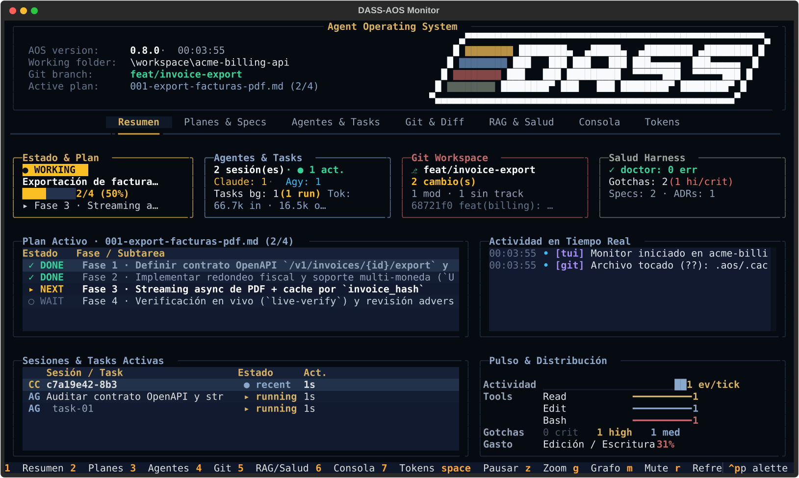
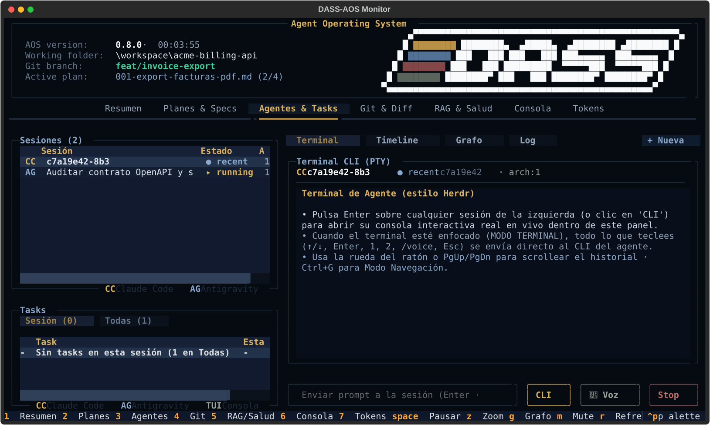
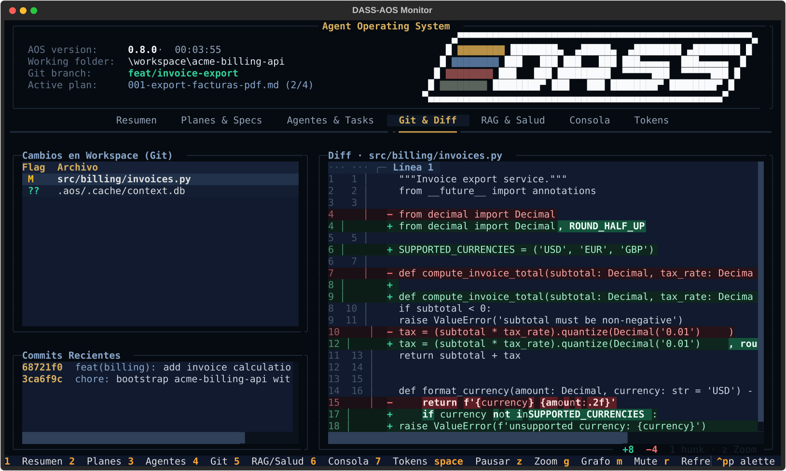
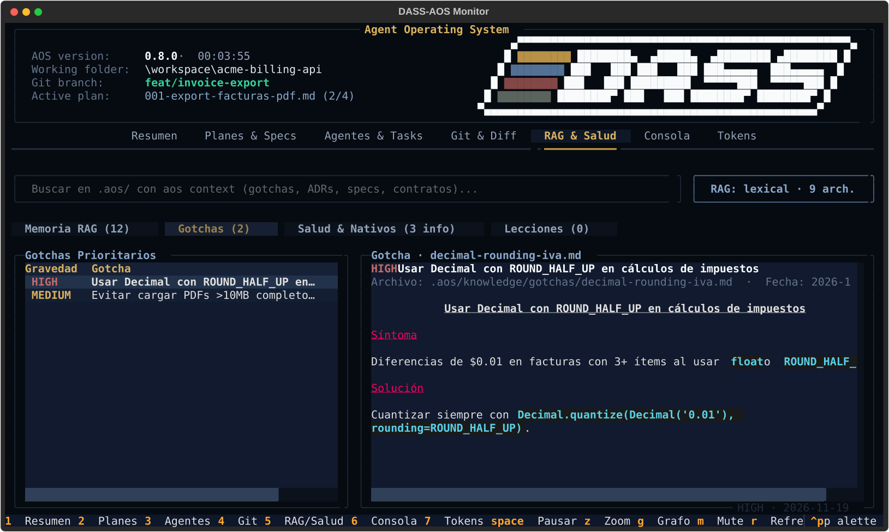
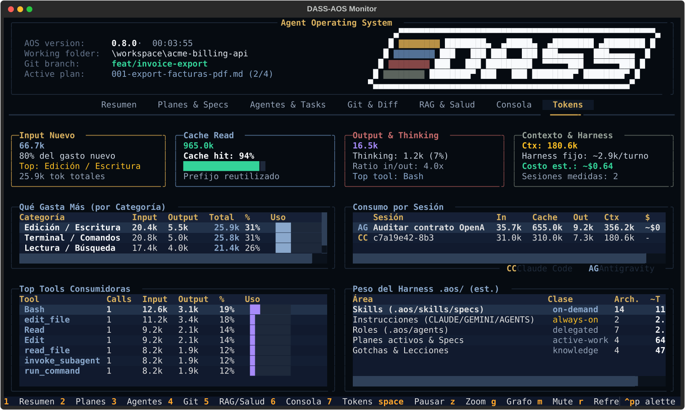
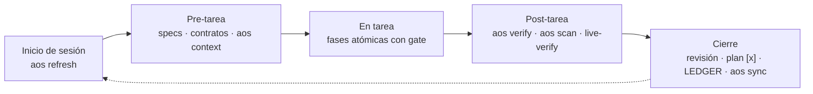

<p align="center">
  
</p>

<h3 align="center">Agent Operating System</h3>

<p align="center">
  Memoria persistente, contratos verificables y un centro de mando en terminal<br>
  para trabajar con agentes de IA sin perder el control del proyecto.
</p>

<p align="center">
  
</p>

<p align="center">
  <a href="https://python.org"></a>
  
  
  
  <a href="LICENSE"></a>
</p>

<p align="center">
  <a href="#inicio-rápido">Inicio rápido</a> ·
  <a href="#por-qué-dass-aos">Por qué DASS-AOS</a> ·
  <a href="#centro-de-mando-en-tiempo-real">Centro de mando (TUI)</a> ·
  <a href="#cómo-funciona">Cómo funciona</a> ·
  <a href="#referencia-de-comandos">Comandos</a> ·
  <a href="docs/ARCHITECTURE.md">Arquitectura</a>
</p>

<p align="center">
  
</p>

<table align="center">
  <tr>
    <td align="center" width="25%">
      <br>
      <sub>Gotchas, <code>LEDGER.md</code>, ADRs y RAG local (<code>aos context</code>) persistentes entre sesiones.</sub>
    </td>
    <td align="center" width="25%">
      <br>
      <sub>PRD → TRD → OpenAPI/CloudEvents. El agente nunca inventa interfaces ni esquemas.</sub>
    </td>
    <td align="center" width="25%">
      <br>
      <sub><code>aos verify</code>, <code>aos scan</code>, <code>live-verify</code> y revisión adversarial con recibo.</sub>
    </td>
    <td align="center" width="25%">
      <br>
      <sub>PTY interactivo, grafo de subagentes, voz <code>/voice</code>, alertas <code>PENDING</code> y tokens.</sub>
    </td>
  </tr>
</table>

**DASS-AOS** es un CLI *stack-agnostic* que le da a tu agente de IA (**Claude Code**, **Antigravity**, **Gemini CLI**, **Codex**, **Cursor**, **Windsurf**, **OpenCode**) lo que no trae de serie: memoria entre sesiones, contratos que no puede inventarse, verificación real antes de cerrar una fase y una **TUI interactiva** para supervisar, hablar y operar sesiones en vivo.

> [!NOTE]
> **Todo vive en `.aos/` dentro de tu repositorio**, en texto plano, versionable y sin *vendor lock-in*. Tú decides qué se construye, apruebas planes y decisiones de arquitectura, y revisas el resultado; el agente ejecuta el trabajo operativo.

---

## Por qué DASS-AOS

| Problema habitual | Qué pasa sin DASS-AOS | Qué hace DASS-AOS |
|---|---|---|
| **Amnesia entre sesiones** | El agente repite errores ya resueltos | `aos refresh` carga gotchas prioritarios, lecciones (`LEDGER.md`), specs y plan activo al iniciar |
| **Degradación arquitectónica** | Cambios que rompen dependencias o decisiones previas | Grafo estructural (`codebase-memory`), ADRs y contexto RAG (`aos context`) antes de editar |
| **Interfaces inventadas** | Endpoints, eventos o schemas que no existen | *Contract-First*: solo se implementa lo declarado en `.aos/contracts/` |
| **Cierres sin evidencia** | Tareas "listas" sin tests, sin probar UI ni revisar riesgos | `aos verify`, `aos scan`, verificación en vivo (`live-verify`) y revisión adversarial con recibo |
| **Poca visibilidad en vivo** | No sabes qué hace cada agente, cuánto gasta ni si está bloqueado | `aos tui`: PTY interactivo, grafo de subagentes, alertas `PENDING`, voz TTS y gasto por tool |

---

## Inicio rápido

### 1. Instalar

```bash
pip install git+https://github.com/Dass-19/dass-aos.git
```

Registra el comando `aos` (equivalente a `python -m dass_aos`). El núcleo usa **solo la biblioteca estándar de Python**; los extras son opcionales:

| Extra | Qué añade | Instalación |
|---|---|---|
| **`tui`** | Centro de mando interactivo en terminal (`aos tui`, Textual, Python ≥ 3.9) | `pip install "dass-aos[tui]"` |
| **`rag`** | Búsqueda semántica híbrida (`fastembed` + `sqlite-vec`; sin él usa `FTS5`/BM25) | `pip install "dass-aos[rag]"` |
| **`scan`** | Análisis estático de seguridad e IaC (`semgrep` + `checkov`) | `pip install "dass-aos[scan]"` |

### 2. Inicializar en tu repositorio

```bash
aos init claude-code antigravity   # indica las herramientas que usas (puedes añadir más luego)
```

Herramientas soportadas: `claude-code`, `antigravity`, `gemini-cli`, `codex`, `opencode`, `cursor`, `windsurf`. Sin argumentos, `aos init` usa las ya configuradas o las detectadas en el repo.

### 3. Abrir el centro de mando

```bash
aos tui
```

<details>
<summary><b>Qué genera <code>aos init</code></b></summary>

- **`.aos/`**: estado local del proyecto (contratos, specs PRD/TRD, planes, gotchas, lecciones, ADRs, roles, skills y configuración).
- **`.aos/config.json`**: comandos de lint/test **autodetectados según el stack** (`package.json`, `pyproject.toml`, `Cargo.toml`, `go.mod`) y lista `deny_paths` de secretos bloqueados en pre-commit.
- **Solo el archivo de instrucciones de tus herramientas** (preservando siempre `## Notas personalizadas del proyecto`): `claude-code` → `CLAUDE.md` · `antigravity` / `gemini-cli` → `GEMINI.md` · `codex` / `opencode` → `AGENTS.md` · `cursor` → `.cursorrules` · `windsurf` → `.windsurfrules`.
- **Nativos de `claude-code` y `antigravity`** vía `aos adapt-native` (subagentes y skills). El hook de inicio de sesión queda pendiente hasta confirmar con `aos adapt-native <herramienta> --yes`.
- **`.git/hooks/pre-commit`**: ejecuta `aos verify` e inspecciona `deny_paths` sin bloquear entornos sin Python/DASS-AOS.

</details>

<details>
<summary><b>Dependencias externas opcionales</b></summary>

`aos refresh` solo avisa de las que aplican a tu proyecto.

| Herramienta | Para qué | Cuándo aplica | Instalación |
|---|---|---|---|
| **Semgrep** | SAST (`aos scan`) | Siempre | `pip install "dass-aos[scan]"` (en Windows nativo: `PYTHONUTF8=1`, WSL o Docker) |
| **Checkov** | IaC, contenedores y pipelines (`aos scan`) | Solo si hay IaC (Terraform, Dockerfile, Helm, CI…) | `pip install "dass-aos[scan]"` |
| **RAG local** | Búsqueda semántica híbrida (`aos context`) | Opcional (sin él funciona léxico `FTS5`) | `pip install "dass-aos[rag]"` |
| **TUI** | Centro de mando en terminal (`aos tui`) | Opcional (Python ≥ 3.9) | `pip install "dass-aos[tui]"` |
| **codebase-memory** | Grafo estructural de código (MCP) | Siempre | Binario `codebase-memory-mcp` en el `PATH`; primera vez: `index_repository` |
| **context7** | Docs actualizadas de librerías (MCP) | Siempre (requerido para `adapt-native` delegado) | Servidor remoto `https://mcp.context7.com/mcp` |
| **playwright-cli** | Verificación web en vivo (`live-verify`) | Solo si hay frontend web | `npm install -g @playwright/cli@latest` y `playwright-cli install --skills -g` |

Los servidores MCP se declaran de forma neutral en `.aos/mcp-config.json`; `adapt-native` los traduce al formato de cada herramienta.

</details>

<details>
<summary><b>Actualizar proyectos existentes (<code>aos update</code>)</b></summary>

Tras actualizar el paquete (`pip install --upgrade --force-reinstall git+https://github.com/Dass-19/dass-aos.git`), ejecuta dentro de tu proyecto:

```bash
aos update
```

Migra `.aos/` a la versión instalada, añade plantillas faltantes, actualiza `pre_commit.py`, resincroniza bloques gestionados, roles/skills del motor y vuelve a ejecutar `adapt-native` respetando siempre tus archivos `*.local.md` y notas humanas.

- Si tenías una skill del motor editada a mano, `aos sync` la protege con `OMITIDO: editado a mano`: mueve lo propio a `<skill>.local.md`, borra el archivo base y vuelve a ejecutar `aos update`.

</details>

---

## Centro de mando en tiempo real

```bash
pip install "dass-aos[tui]"
aos tui [--interval 1.5]
```

Más que un visor pasivo, `aos tui` es un **centro de mando interactivo** sobre `.aos/`, Git y tus sesiones locales de Claude Code y Antigravity:

- **Terminal CLI embebido (PTY / ConPTY VT100 TrueColor)**: conecta sesiones en vivo con scrollback de 1,200 líneas, zoom a pantalla completa (`z`), validación automática de CLI (`claude` / `agy`) con instalador guiado si falta, y creación de sesiones nombradas (`+ Nueva`).
- **Grafo de Subagentes y Workflows en vivo (`g`)**: topología en tiempo real del coordinador, subagentes delegados, pipelines y flujo de mensajes (`send_message` / `recv_message`).
- **Alertas `PENDING` + Modo Voz (`/voice` TTS)**: detecta cuando un agente espera tu aprobación o respuesta y avisa con banner, sonido y notificación del SO (`m` para silenciar); el botón **`🎤 Voz`** lee en voz alta las respuestas limpias de código/diffs.
- **Diff estilo Delta + RAG maestro–detalle**: diffs con doble número de línea y resaltado intra-línea; vista maestro–detalle para explorar resultados RAG, Markdown completo de gotchas, hallazgos de `aos doctor` y lecciones de `LEDGER.md`.
- **Telemetría lazy y costo USD estimado**: ticks rápidos (~43 ms), arranque en dos fases (<170 ms al primer pintado) y desglose de tokens con costo exacto (Claude Code) y estimado equivalente en API `~$` (Antigravity).

<table>
  <tr>
    <td></td>
    <td></td>
  </tr>
  <tr>
    <td align="center"><sub><b>Agentes &amp; Tasks</b> · PTY en vivo, vistas Terminal/Timeline/Grafo/Log, voz y tasks por sesión</sub></td>
    <td align="center"><sub><b>Git &amp; Diff</b> · estilo Delta con doble gutter, stats y resaltado intra-línea</sub></td>
  </tr>
  <tr>
    <td></td>
    <td></td>
  </tr>
  <tr>
    <td align="center"><sub><b>RAG &amp; Salud</b> · memoria <code>aos context</code>, Markdown de gotchas, <code>aos doctor</code> y <code>LEDGER.md</code></sub></td>
    <td align="center"><sub><b>Tokens</b> · consumo por categoría, top tools, peso del harness y costo USD (<code>~$</code> en Agy)</sub></td>
  </tr>
</table>

| Tecla | Pestaña | Qué ofrece |
|---|---|---|
| `1` | **Resumen** | KPIs de plan, agentes, Git y salud · fases activas · pulso y feed en vivo |
| `2` | **Planes & Specs** | Navegador maestro–detalle de planes activos/archivados, PRD/TRD y ADRs |
| `3` | **Agentes & Tasks** | Sesiones CC/AG · tasks filtradas por sesión · vistas `Terminal / Timeline / Grafo / Log` · prompt + `CLI` + `🎤 Voz` + `Stop` |
| `4` | **Git & Diff** | Workspace changes · commits recientes · diff estilo Delta (y `.md` renderizado) |
| `5` | **RAG & Salud** | Buscador `aos context` (`/`) · sub-vistas `Memoria RAG / Gotchas / Salud & Nativos / Lecciones` |
| `6` | **Consola** | Runner no bloqueante con `Verify (v)`, `Scan (s)`, `Update (u)` y `Doctor` |
| `7` | **Tokens** | Input, cache hit %, output/thinking, contexto, top tools, sesiones y peso del harness `.aos/` |

> **Atajos rápidos**: `z` zoom contextual · `g` grafo de subagentes · `m` silenciar alertas · `n` nueva sesión · `u` update · `space` pausar · `r` refrescar · `t` cambiar tema (`Cyan` · `Emerald` · `Violet`) · `?` ayuda · `q` salir.

<details>
<summary><b>De dónde salen los datos locales de sesiones y tokens</b></summary>

Todo se lee localmente en modo solo lectura sin enviar nada a servidores externos:
- **Claude Code**: `~/.claude/projects/<slug>/*.jsonl` y `<sesión>/subagents/*.jsonl`, deduplicado por `message.id:requestId` (misma regla que `ccusage`).
- **Antigravity**: almacenes duales `~/.gemini/antigravity/` (IDE) y `~/.gemini/antigravity-cli/` (CLI), correlacionados por `workspace_uris` en `conversation_summaries.db` y transcripts locales.

</details>

---

## Cómo funciona

Cada tarea recorre el mismo ciclo auditable. Sus especificaciones viven en `.aos/hooks/` (`session-start.md`, `pre-task.md`, `post-task.md`):



| Fase | Tú | El agente |
|---|---|---|
| **Setup** | `aos init` una vez por repositorio | — |
| **Contexto** | Notas en `CLAUDE.md`/`GEMINI.md` y `.aos/**/*.local.md` | Lee las directivas de su bloque gestionado |
| **Inicio de sesión** | Plantea el objetivo | `aos refresh`: gotchas prioritarios, specs abiertas y plan activo |
| **Planificación** | Revisa y aprueba el plan / PRD / TRD | `aos spec new` y `aos plan new`: fases atómicas y contratos en `.aos/contracts/` |
| **Implementación** | Supervisa en `aos tui` y resuelve bloqueos `PENDING` | Codifica en unidades atómicas ligadas al contrato |
| **Verificación** | Revisa reportes y evidencia | `aos verify`, `aos scan`, `live-verify` y `adversarial-review` |
| **Cierre** | Aprueba commit, merge y push | Marca la fase `[x]`, registra gotchas/lecciones y ejecuta `aos sync` |

### Requisitos: PRD → TRD → contratos → plan

El *qué* y el *por qué* no se reconstruyen adivinando el diff ([ADR-007](.aos/decisions/ADR-007-capa-de-requisitos-y-grafo-de-codigo.md)). Viven en `.aos/specs/`:

| Documento | Responde a | Lo revisa |
|---|---|---|
| `NNN-<slug>.prd.md` | **PRD**: qué problema, para quién y **criterios de aceptación medibles** | Producto / negocio |
| `NNN-<slug>.trd.md` | **TRD**: cómo se construye y por qué así; contratos, datos, riesgos y plan de prueba | Ingeniería |

```bash
aos spec new prd --title "Export de facturas"   # → .aos/specs/001-export-de-facturas.prd.md
aos spec new trd --title "Export de facturas"   # → .aos/specs/001-export-de-facturas.trd.md
```

> [!TIP]
> **Vía corta**: un cambio pequeño y bien comprendido no necesita PRD. Cuando sí hay spec, **se cita por ruta y sección, nunca se parafrasea**, y sobrevive cuando el plan se archiva.

### Entrega por riesgo

Cuatro skills del motor ([ADR-006](.aos/decisions/ADR-006-flujo-de-entrega-del-motor.md), [ADR-008](.aos/decisions/ADR-008-enrutado-por-riesgo-y-revision-con-recibo.md)) deciden la profundidad del proceso **por riesgo y comprensión, nunca por número de archivos**:

| Skill | Cuándo se activa | Qué garantiza |
|---|---|---|
| **`spec-driven`** | Funcionalidad con alcance de producto | PRD medible → TRD que cita el PRD → contratos → plan enlazado |
| **`phased-delivery`** | Cambios con riesgo nombrado (datos, seguridad, contratos, concurrencia, entrega) | Línea base → exploración → decisiones → fases con `Gate:` → implementación → cierre |
| **`live-verify`** | Al cerrar fases que tocan UI, API, CLI o escritorio | Levanta la app en entorno desechable, la ejercita de verdad y corrige (≤ 3 rondas) |
| **`adversarial-review`** | Cambios con riesgo nombrado antes de cerrar fase | Congela candidato → lentes por tier (0 / 1 / 4R) → `adversarial-verifier` intenta refutar cada hallazgo → una sola corrección acotada |

---

## Adaptar DASS-AOS al proyecto

Los roles y skills del motor son genéricos a propósito y se extienden sin tocar los archivos generados ([ADR-003](.aos/decisions/ADR-003-base-motor-agregados-locales.md)):

| Quiero… | Hago… |
|---|---|
| Añadir reglas propias a un rol del motor | Crear `.aos/agents/<rol>.local.md` (`aos sync` lo anexa automáticamente) |
| Ajustar una skill del motor (gates, lentes, entorno) | Crear `.aos/skills/specs/<skill>.local.md` |
| Crear un rol o skill exclusivo del proyecto | Crear `.aos/agents/<nuevo>.md` o `.aos/skills/specs/<nueva>.md` |
| Recibir mejoras del motor sin perder lo propio | `pip install -U ... && aos update` (conserva todos los `.local.md`) |
| Personalizar comandos de verificación | Editar `lint_command`, `test_command` o `migration_command` en `.aos/config.json` |

### Integración nativa (`aos adapt-native`)

`.aos/` es la fuente única. Cada herramienta consume sus propios formatos locales (subagentes, skills, hooks), que se generan por desarrollador y quedan fuera de git:

```bash
aos adapt-native claude-code --yes      # o: antigravity  (--dry-run previsualiza sin escribir)
```

<details>
<summary><b>Comparativa Claude Code vs Antigravity 2.0</b></summary>

| Capacidad | Claude Code | Antigravity 2.0 |
|---|---|---|
| **Roles** | `.claude/agents/<rol>.md`; `tools_allowed` → `disallowedTools` (**nativo**) | Bloque gestionado en `GEMINI.md` delega con `define_subagent` indicando roles solo lectura (**convención**) |
| **Skills** | `.claude/skills/<x>/SKILL.md` | `.agents/skills/<x>/SKILL.md` |
| **Inicio de sesión** | Hook `SessionStart` en `.claude/settings.local.json` (**nativo**) | Hook `PreInvocation` en `.agents/hooks.json` inyecta `aos refresh` una vez por sesión (**emulado**) |
| **MCP** | Usuario (`~/.claude.json`) o plugin | Global (`~/.gemini/config/mcp_config.json`) |

Para otras herramientas (Codex, Cursor, OpenCode, Gemini CLI…), la skill `adapt-native` ([ADR-004](.aos/decisions/ADR-004-adaptacion-nativa-delegada.md)) consulta el formato vigente y genera el equivalente desde `.aos/`.

</details>

### Auditoría y estado (`aos doctor`, `aos status`)

```bash
aos doctor            # diagnóstico solo lectura (no modifica archivos ni bloquea commits)
aos doctor --strict   # sale con código 1 si hay hallazgos de nivel error
aos status [--json]   # Working | Checking | Ready | Needs decision (derivado de archivos)
```

---

## Referencia de comandos

### Flujo diario y monitoreo

| Comando | Función | Quién lo usa |
|---|---|---|
| `aos init [<herramienta>...]` | Inicializa `.aos/`, archivos de instrucciones y nativos | Desarrollador |
| `aos tui [--interval <seg>]` | Centro de mando interactivo en terminal (requiere `[tui]`) | Desarrollador |
| `aos refresh [--gotchas-limit N]` | Gotchas recientes, specs abiertas, estado nativo y siguiente tarea | Agente (inicio) |
| `aos context [<query>] [--kind K] [--limit N] [--json]` | Recupera fragmentos de `.aos/` (RAG híbrido o `FTS5`) | Agente / Dev |
| `aos verify [--type lint\|test\|migration] [--strict]` | Ejecuta linters, tests y migraciones configuradas | Agente / Dev |
| `aos scan [--tool semgrep\|checkov] [--dry-run]` | Escaneo SAST (Semgrep) e IaC (Checkov) | Agente / Dev |

### Planes, specs y contratos

| Comando | Función | Quién lo usa |
|---|---|---|
| `aos plan new <tipo> --title <título>` | Crea plan activo (`feature`, `bugfix`, `refactor`, `security`) | Agente (pre-tarea) |
| `aos spec new prd\|trd --title <título>` | Crea `.aos/specs/NNN-<slug>.{prd,trd}.md` emparejados | Agente (pre-tarea) |
| `aos generate-client --contract <ruta>` | Genera stubs de cliente tipados desde OpenAPI | Agente / Dev |

### Harness, mantenimiento e integración

| Comando | Función | Quién lo usa |
|---|---|---|
| `aos update [--project-root <ruta>]` | Migra `.aos/`, plantillas, instrucciones y nativos en proyectos existentes | Desarrollador |
| `aos sync [--project-root <ruta>]` | Regenera bloques gestionados y roles/skills base preservando `.local.md` | Agente / Dev |
| `aos adapt-native <herramienta> [--dry-run] [--yes]` | Genera nativos de `claude-code` o `antigravity` desde `.aos/` | Desarrollador |
| `aos doctor [--strict]` | Audita coherencia del harness `.aos/` (solo lectura) | Agente / Dev |
| `aos status [--json]` | Estado objetivo del proyecto (`Working`, `Checking`, `Ready`, `Needs decision`) | Agente / Dev |
| `aos native-hash` / `aos refresh --hook antigravity` | Utilidades internas para manifiestos y hook de Antigravity | Hooks / Agente |

<details>
<summary><b>Roles de agentes incluidos (<code>.aos/agents/</code>)</b></summary>

| Rol | Responsabilidad |
|---|---|
| `app-builder` | Diseño e implementación end-to-end por fases, guiada por contratos |
| `architect` | ADRs, contratos y límites del sistema |
| `reviewer` | Revisión de código y seguridad en formato `file:line` (solo lectura) |
| `refactorer` | Mejoras estructurales sin cambiar el comportamiento observable |
| `security-auditor` | Autenticación, secretos, IaC y dependencias (solo lectura) |
| `qa-tester` | Tests, regresiones, smoke tests de contratos y evidencia `live-verify` |
| `adversarial-verifier` | Intenta refutar cada hallazgo de revisión contra el código real (solo lectura) |

</details>

<details>
<summary><b>CI/CD incluido (<code>.aos/ci/</code>)</b></summary>

`aos init` deja listos `github-actions/security.yml` y `gitlab/security.yml` para ejecutar Semgrep y Checkov en modo estricto dentro de contenedores, replicando en CI las mismas comprobaciones locales.

</details>

---

## Estructura

<details>
<summary><b>Proyecto gestionado (<code>.aos/</code>)</b></summary>

```text
mi-proyecto/
├── .aos/
│   ├── config.json            Comandos de verificación + deny_paths del pre-commit
│   ├── mcp-config.json        Servidores MCP neutrales (codebase-memory, context7)
│   ├── native/                Manifiestos de adapt-native (por dev, fuera de git)
│   ├── .backups/              Snapshots previos a reescrituras (fuera de git)
│   ├── agents/                Roles del motor + *.local.md del proyecto
│   ├── skills/specs/          Skills del motor + *.local.md del proyecto
│   ├── skills/bin/            Helpers ejecutables (smoke test, commit atómico)
│   ├── hooks/                 Especificaciones de lifecycle + pre_commit.py
│   ├── contracts/             OpenAPI 3.x y CloudEvents schemas
│   ├── specs/                 PRD y TRD (NNN-<slug>.prd.md / .trd.md)
│   ├── plans/{active,archive,templates}/
│   ├── knowledge/gotchas/     Trampas y aprendizajes no obvios
│   ├── knowledge/lessons/     LEDGER.md: lecciones con evidencia
│   ├── decisions/             ADRs del proyecto
│   └── ci/                    Pipelines de seguridad listos para copiar
└── CLAUDE.md, GEMINI.md, AGENTS.md, .cursorrules, .windsurfrules
```

</details>

<details>
<summary><b>Motor (<code>dass_aos/</code>)</b></summary>

```text
dass-aos/
├── pyproject.toml
├── aos.py                     Atajo CLI desde el código fuente
├── dass_aos/
│   ├── cli.py                 Entrada del CLI (`aos` / `python -m dass_aos`)
│   ├── bootstrap.py           aos init
│   ├── update.py              aos update (migración de proyectos existentes)
│   ├── sync.py                aos sync (bloques gestionados + roles/skills)
│   ├── memory.py              aos refresh
│   ├── rag.py                 aos context (SQLite FTS5 + sqlite-vec opcional)
│   ├── scanners.py            aos scan (Semgrep / Checkov)
│   ├── verifier.py            aos verify (lint / test / migración)
│   ├── generator.py           aos generate-client
│   ├── plans.py               aos plan new
│   ├── specs.py               aos spec new (PRD/TRD)
│   ├── doctor.py              aos doctor (auditoría del harness)
│   ├── status.py              aos status (estado derivado de archivos)
│   ├── ui.py                  Tarjetas y badges TrueColor para consola
│   ├── telemetry.py           Agregador lazy (.aos/, Git, Claude Code, Antigravity)
│   ├── tui/                   aos tui (app, widgets, controller, ConPTY/PTY VT100)
│   ├── native/                Generadores nativos (claude-code, antigravity)
│   ├── backup.py              Snapshots previos a sobrescritura
│   └── templates/             Plantillas embebidas que copia `aos init`
├── docs/
│   ├── ARCHITECTURE.md
│   ├── CODE-GRAPH-OPTIONS.md
│   └── assets/                Logo y capturas SVG/PNG de `aos tui`
└── tests/
```

</details>

---

## Desarrollo y licencia

Arquitectura y decisiones de diseño en [docs/ARCHITECTURE.md](docs/ARCHITECTURE.md). Guía de contribución en [CONTRIBUTING.md](CONTRIBUTING.md).

```bash
ruff check .
python -m unittest discover -b -s tests -p "test_*.py"
```

<p align="center">
  
</p>

<p align="center">
  <sub>Distribuido bajo licencia <b>MIT</b> — ver <a href="LICENSE">LICENSE</a></sub>
</p>
